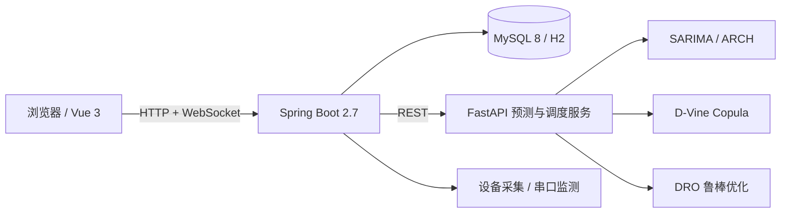

# 光储智慧能源管理平台

面向工商业园区与光储充一体化场站的监控、调度与能量管理平台。系统提供设备接入、实时监控、调度策略、储能优化、充电管理、安全监测、告警与报表能力，支持 MySQL 生产部署和内置 H2 的 Windows 桌面发行版。

> **Windows 用户请从 [Releases](https://github.com/IIIIIzzhIIIII/smart-energy-storage-management-system/releases/latest) 下载发行包**，解压后双击根目录的 `EnergyMonitor.exe`。仓库首页 `Code → Download ZIP` 仅包含源码，不含可执行文件、运行时和数据库。

[](https://github.com/IIIIIzzhIIIII/smart-energy-storage-management-system/releases/latest)


## 项目概览

平台采用前后端分离架构，后端提供 REST API 与 WebSocket 实时数据通道，前端以单页应用呈现监控大屏和业务页面；预测与优化服务独立运行，通过 HTTP 与主服务协作。

主要面向以下场景：

- 工商业储能电站的实时监控与运行分析
- 光伏、储能、充电桩协同调度
- 园区负荷削峰填谷与需量控制
- 无现场设备条件下的系统联调、功能验证与算法评估

## 核心能力

| 模块 | 能力 |
|------|------|
| 用户与权限 | 基于角色的访问控制（RBAC），支持管理员、调度员、普通用户、只读用户 |
| 设备管理 | 光伏、PCS、电表、负载、电网、充电桩等设备台账与通讯参数管理 |
| 实时监控 | 功率、电量、SOC 等指标实时刷新，支持历史曲线与全天功率曲线 |
| 调度策略 | 计划曲线、削峰填谷、自发自用、需量控制及策略优先级 |
| 光储充协同 | 谷时充电、峰时避峰、光伏余电充电及充电订单管理 |
| 优化调度 | SARIMA/ARCH 预测、D-Vine Copula 场景生成、分布鲁棒优化（DRO） |
| 安全监测 | 温湿度传感器接入、协议识别、串口帧监测与越限告警 |
| 告警管理 | 阈值规则、越限检测、WebSocket 推送与告警处置 |
| 能量流分析 | 桑基图展示光伏、储能、负载与电网之间的能量流向 |
| 统计报表 | 发电、用电、充放电与收益的日/月报表，支持峰平谷电价 |

## 系统架构



## 技术栈

| 层级 | 技术 |
|------|------|
| 后端 | Java 17、Spring Boot 2.7、MyBatis-Plus、WebSocket、Spring Task、JWT |
| 数据库 | MySQL 8.0（开发与生产）、H2 文件数据库（桌面发行版） |
| 前端 | Vue 3、Element Plus、ECharts、Axios、Pinia、Vite |
| 预测与优化 | Python、FastAPI、statsmodels、arch、pyvinecopulib、NumPy/Pandas |
| 桌面运行时 | .NET Framework 启动器、jlink 精简 JRE、PyInstaller |

## Windows 桌面发行版

发行包已内置精简 JRE、H2 数据库、前端静态资源和 Python 预测服务，目标机器无需安装 Java、MySQL、Node.js 或 Python。

> **请从 Releases 下载发行包。** 仓库首页 `Code → Download ZIP` 只包含源码，不包含编译后的启动器、运行时和数据库。

### 获取与启动

1. 打开 [Releases](https://github.com/IIIIIzzhIIIII/smart-energy-storage-management-system/releases/latest)；
2. 下载 `EnergyMonitor-v1.1.1-win64.zip`；
3. 完整解压到本地目录，例如 `D:\EnergyMonitor`；
4. 双击压缩包**根目录**下的 `EnergyMonitor.exe`；
5. 首次启动会创建数据库并生成示例历史数据，通常需要 30~90 秒；
6. 浏览器自动打开 `http://127.0.0.1:8082`，使用默认账号登录。

发行包解压后的目录结构：

```text
EnergyMonitor\
├── EnergyMonitor.exe        # 桌面启动器，位于根目录
├── app\
│   └── energy-monitor.jar   # 后端服务（已内置前端页面）
├── runtime\                 # 精简 JRE 17
├── python\                  # 预测与 DRO 服务
├── data\                    # H2 数据库文件
├── logs\                    # 运行日志
├── docs\                    # 使用文档
├── README.md
└── 使用说明.md
```

数据默认保存在 `data\energy_monitor.mv.db`。迁移或备份时，停止程序后复制整个 `data` 目录即可。

## 从源码运行

### 环境要求

| 工具 | 版本 | 用途 |
|------|------|------|
| JDK | 17 | 后端编译与运行 |
| Maven | 3.9+ | 后端依赖管理 |
| MySQL | 8.0 | 开发与生产数据库 |
| Node.js | 18 LTS+ | 前端构建 |
| Python | 3.9~3.13 | 预测与调度服务 |

### 1. 初始化数据库

```bash
mysql -uroot -p < backend/sql/init.sql
```

### 2. 启动后端

```powershell
cd backend
Copy-Item src\main\resources\application-local.yml.example src\main\resources\application-local.yml
# 编辑 application-local.yml，填写数据库密码、JWT 密钥和天气 API Key
mvn spring-boot:run
```

后端默认监听 `8082`。

### 3. 启动前端

```bash
cd frontend
npm install
npm run dev
```

开发页面地址为 `http://localhost:5173`，Vite 会将 `/api` 与 `/ws` 代理到后端。

### 4. 启动预测与调度服务

```bash
cd python-ems
pip install -r requirements.txt
python main.py
```

服务默认监听 `127.0.0.1:8000`，接口文档位于 `http://localhost:8000/docs`。该服务未启动时，实时监控、设备与报表等功能仍可使用，仅预测和 DRO 调度不可用。


## 配置说明

敏感配置不写入源码。后端通过 `application-local.yml` 或环境变量注入，Python 服务通过 `python-ems/.env` 注入。

| 变量 | 默认值 | 说明 |
|------|--------|------|
| `DB_USERNAME` | `root` | MySQL 用户名 |
| `DB_PASSWORD` | 无 | MySQL 密码 |
| `JWT_SECRET` | 本地开发值 | JWT 签名密钥，部署前必须替换 |
| `WEATHER_API_KEY` | 空 | 和风天气 API Key，可选 |
| `WEATHER_API_HOST` | `https://devapi.qweather.com` | 天气 API 地址 |

## 源码目录

```text
smart-energy-storage-management-system/
├── backend/                  # Spring Boot 后端
│   ├── sql/                  # MySQL 初始化与增量脚本
│   └── src/main/
│       ├── java/com/energy/  # controller / service / mapper / entity / config
│       └── resources/
│           ├── application.yml
│           ├── application-release.yml
│           └── db/           # H2 建表与示例数据
├── frontend/                 # Vue 3 前端
│   └── src/                  # layout / views / router / store / utils
├── python-ems/               # 预测与 DRO 调度服务
├── launcher/                 # Windows 桌面启动器源码
├── scripts/                  # 发行构建脚本
└── docs/                     # 部署、构建与使用文档
```

## 主要接口

| 方法 | 路径 | 说明 |
|------|------|------|
| `POST` | `/api/auth/login` | 用户登录 |
| `GET` | `/api/health` | 服务健康检查（免登录） |
| `GET` | `/api/monitor/snapshot` | 实时监控快照 |
| `GET` | `/api/monitor/energy-flow` | 能量流数据 |
| `GET` | `/api/dispatch/dro-plan` | DRO 调度计划 |
| `GET` | `/api/report/day` | 日报表 |
| `WS` | `/ws/monitor` | 实时数据推送 |

## 默认账号

| 账号 | 密码 | 角色 |
|------|------|------|
| `admin` | `123456` | 管理员 |
| `dispatcher` | `123456` | 调度员 |
| `user` | `123456` | 普通用户 |
| `viewer` | `123456` | 只读用户 |

数据权限按设备归属控制：管理员可管理全站数据；调度员和普通用户只能访问自己名下的设备及关联数据；只读用户只能查看。

> 默认密码仅用于本地初始化。部署到共享或公网环境前，请修改默认密码、替换 `JWT_SECRET`，并启用 HTTPS。

## 部署建议

- 生产环境使用 MySQL，并将数据库、JWT 密钥和天气 API Key 通过环境变量或外部配置注入；
- 前端由 Spring Boot 直接托管时只需开放 `8082`；使用 Nginx 时请正确代理 `/api` 与 `/ws`；
- 预测服务默认仅监听本机，若独立部署需配置访问控制；
- 桌面发行版默认启用模拟采集，接入真实设备时请配置串口参数并切换采集模式；
- 定期备份 `data` 目录或 MySQL 数据库。

## 文档

- [Windows 桌面版使用说明](docs/桌面版使用说明.md)
- [Windows 发行版构建](docs/发行版构建.md)
- [部署文档](docs/部署文档.md)
- [版本发布说明](docs/发布说明-v1.1.1.md)
